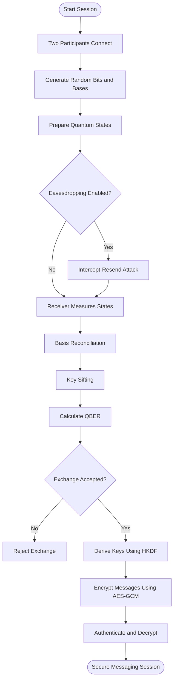
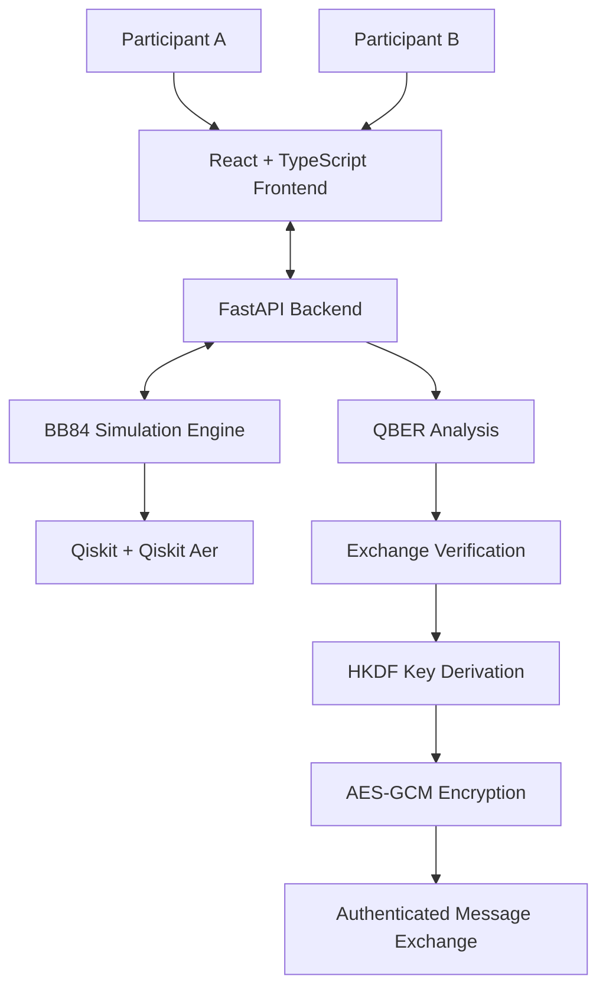

# ⚛️ QubiFide — Quantum-Safe Communication Simulation

### A BB84-Based Framework for Secure Communication & Eavesdropping Analysis

  <strong>Simulating Quantum Key Distribution • Detecting Eavesdropping • Securing Messages</strong>

  
  
  
  
  

---

## 🌌 Overview

**QubiFide** is an interactive web-based application that demonstrates how Quantum Key Distribution (QKD) can be integrated with classical cryptographic techniques to establish secure communication.

Built around the **BB84 Quantum Key Distribution Protocol**, QubiFide simulates quantum state preparation, measurement, basis reconciliation, and key sifting between two communicating participants.

It also introduces an optional **Intercept-Resend Attack**, allowing users to observe how an eavesdropper can disturb quantum states and increase the Quantum Bit Error Rate (QBER).

Once a key exchange satisfies the configured acceptance conditions, the application uses **HKDF** for application key derivation and **AES-GCM** for authenticated message encryption.

The goal is to make quantum cryptography concepts interactive, understandable, and experimentally observable.

## ✨ Key Features

- **Quantum Key Distribution (BB84):** Simulates quantum state preparation and measurement using computational and diagonal bases.
- **Eavesdropping Simulation:** Implements an optional Intercept-Resend Attack to demonstrate quantum measurement disturbance.
- **QBER Analysis:** Calculates the Quantum Bit Error Rate to evaluate mismatches in sampled sifted bits.
- **Exchange Verification:** Accepts or rejects key exchanges according to configured QBER thresholds and key-material requirements.
- **Cryptographic Key Derivation:** Uses HKDF to derive application encryption keys from the accepted key material.
- **Authenticated Encryption:** Uses AES-GCM to encrypt and authenticate exchanged messages.
- **Session Management:** Allows two participants to create and join communication sessions.
- **Secure Messaging Workflow:** Enables messaging only after the key exchange has been accepted.
- **Interactive Interface:** Provides an interface to observe exchange status, QBER results, and encrypted communication.

## 🔬 How It Works

QubiFide follows a sequence of operations combining quantum simulation and classical cryptography.

### 1. Quantum Key Distribution

- Generate random classical bits.
- Randomly select preparation bases.
- Encode bits into quantum states.
- Measure the states using randomly selected receiver bases.
- Compare the bases and retain only matching positions.

### 2. Eavesdropping Analysis

An optional attacker, Eve, intercepts the quantum states, measures them using randomly selected bases, and prepares replacement states.

When Eve chooses an incompatible basis, measurement disturbance can introduce errors into the receiver's results.

This allows the application to compare normal and intercepted exchanges.

### 3. QBER Calculation

The Quantum Bit Error Rate measures the proportion of mismatched bits in the sampled key.

\[
QBER = \frac{\text{Number of Errors}}{\text{Total Bits Compared}} \times 100
\]

A higher QBER indicates more mismatches in the sample.

For an ideal BB84 scenario with a full intercept-resend attack and randomly selected bases, the expected QBER is approximately **25%**.

### 4. Key Derivation and Encryption

After an exchange is accepted:

- HKDF derives application encryption keys.
- AES-GCM encrypts plaintext messages.
- An authentication tag is generated alongside the ciphertext.
- The receiver verifies the authentication tag before decrypting the message.

## 🏗️ System Architecture

QubiFide follows a client-server architecture with separate frontend, backend, quantum simulation, and cryptographic components.

| Component | Technology | Responsibility |
|---|---|---|
| Frontend | React, TypeScript, Vite | User interface and session interaction |
| Backend | Python, FastAPI | API handling and session coordination |
| Quantum Simulation | Qiskit | Quantum circuit construction |
| Simulation Backend | Qiskit Aer | Quantum circuit execution |
| Key Derivation | HKDF | Application key generation |
| Encryption | AES-GCM | Message confidentiality and authentication |

### Architecture Overview

## 🛠️ Technology Stack

**Frontend**
- React
- TypeScript
- Vite

**Backend**
- Python
- FastAPI

**Quantum Computing**
- Qiskit
- Qiskit Aer

**Cryptography**
- HKDF
- AES-GCM

## 👨‍💻 Contributors

**Akshat Kumar**  
**Jaswant Swaram**

Department of Computer Science and Engineering  
Indian Institute of Information Technology, Bhopal

**Project Supervisor:** Dr. Supriyo Mandal

---

  <strong>QubiFide — Exploring the Intersection of Quantum Computing and Cryptography.</strong>
   
  Built with curiosity, mathematics, and code. ⚛️

